# FieldRota-AI

**A reinforcement-learning planner that tells a farmer what to plant next, so the field pumps less groundwater, now and in a hotter future.**

**Track:** Climate · Veritas AI International High School Hackathon 2026

**[▶ Demo video (2 min)](https://youtu.be/iyL9VEknNFA)** · **[Live app](https://mensar10.github.io/fieldrota-ai/app/)** (section 5 is the AI planner) · **[Notebook in Colab](https://colab.research.google.com/github/Mensar10/fieldrota-ai/blob/main/FieldRota_AI.ipynb)** (all tests, about 5 minutes) · **[Technical details](DETAILS.md)**

> **In one line:** FieldRota-AI tells a farmer on Türkiye's Konya Plain what to plant every year until 2060. In our simulator, on weather years and climate models it never trained on, its plan follows the new 2027 rules and pumps **45–48 % less groundwater** than today's rotation, matching the exact optimum on the unseen climate models. At today's prices the water-saving plan earns less; we show that trade-off openly, with our plan to fix it.
>
> Research prototype; not agronomic or financial advice.

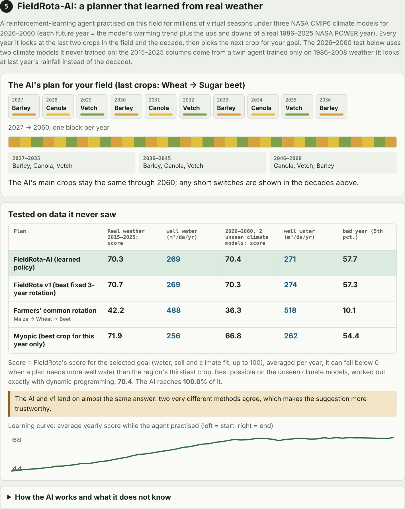
*Section 5 of the app. The farmer's field last grew wheat, then sugar beet. The agent plans barley → canola → vetch until 2060, and the table shows how it did on years and climate models it did not train on.*

[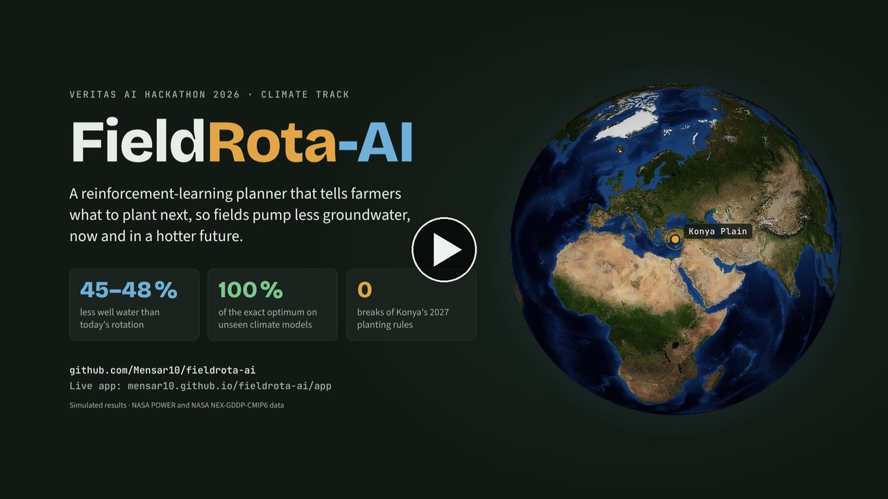](https://youtu.be/iyL9VEknNFA)
*The 2-minute demo: the problem, the app, the AI's plan, the honest test and where it falls short. Click to watch on YouTube.*

---

## The problem

On the Konya Plain, irrigation wells drain the aquifer faster than rain refills it. NASA's GRACE satellites see the basin losing water every year, and hundreds of sinkholes have opened. From 2027, irrigated fields in the Çumra district must follow new rules:

* only crops on the district's list may be planted, and **sugar beet is no longer on it**;
* a field needs at least **three different crops** in rotation;
* water-hungry crops (grain maize, potato, alfalfa, sugar beet) **may not follow each other** or come more than twice in four years.

Summers are also getting hotter. So every autumn a farmer has one question: *what do I plant next on this field, so that I pump less water now and still do well in a hotter future?*

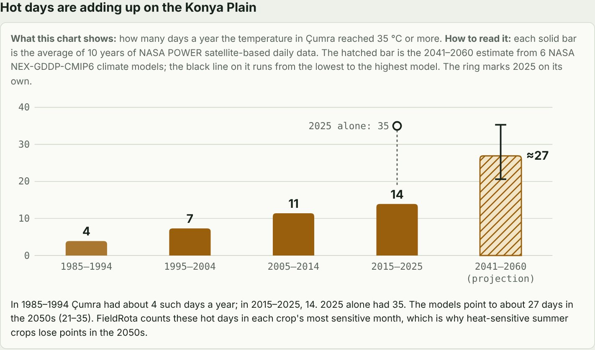
*From the app: days at or above 35 °C in Çumra went from about 4 a year in 1985–1994 to 14 in 2015–2025. 2025 alone had 35. NASA's climate models point to about 27 a year in the 2050s.*

## What we built

**The user:** a farmer with an irrigated field near Çumra, in the autumn, choosing next season's crop.

* **In:** the field's last crops (for example wheat, then sugar beet) and a goal: *save water*, *healthy soil* or *balanced*.
* **Out:** a crop for every year from 2027 to 2060 that follows the 2027 rules, with the expected well water, climate fit (how well the crop copes with that year's heat) and soil health.

It lives in our web app, FieldRota. The farmer finds the field on a satellite map, enters what they grew, picks a goal, and gets two answers: a simple best 3-year rotation (v1, section 4) and the learned year-by-year plan (FieldRota-AI, section 5).

| 1. Find your field | 4. A simple first answer (v1) |
|---|---|
| 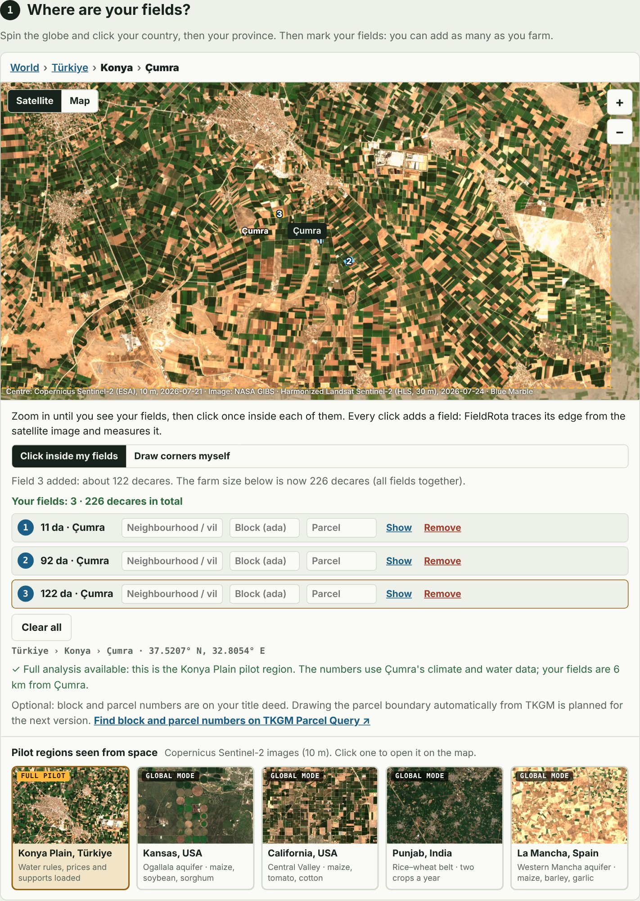 | 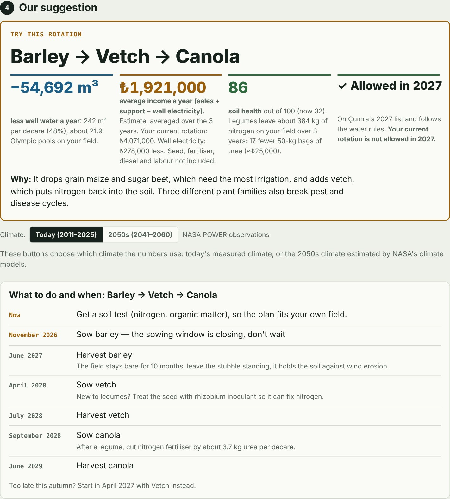 |
| *Click inside each field on NASA HLS and Sentinel-2 imagery; the app traces the field and measures its area.* | *v1 scores every legal 3-year rotation with the average climate and suggests the best one, with a sowing calendar.* |

<b>More of the app: globe, inputs and side-by-side comparison</b>

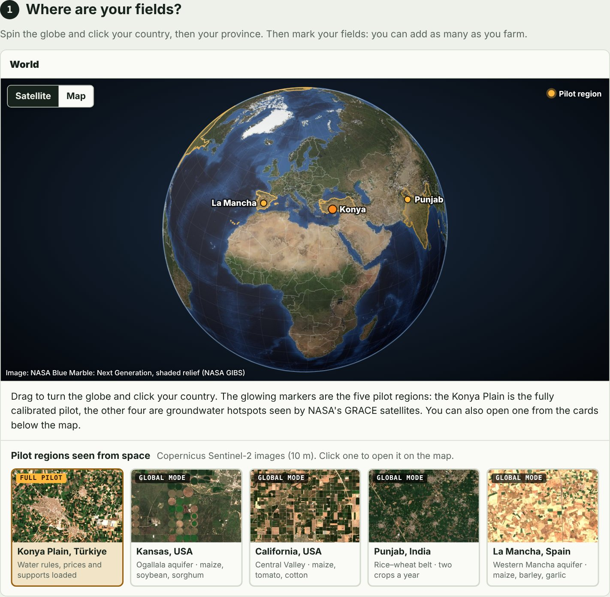
*Start on the globe. The five pilot regions are groundwater hotspots: Konya, Kansas, California, Punjab and La Mancha.*

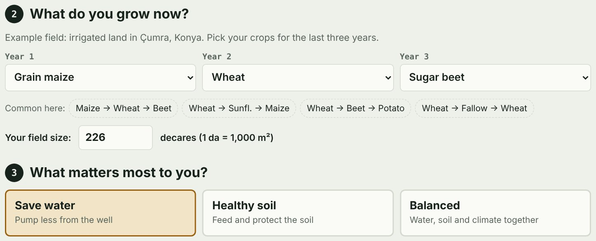
*Sections 2 and 3: the last three crops on the field, the field size, and the goal.*

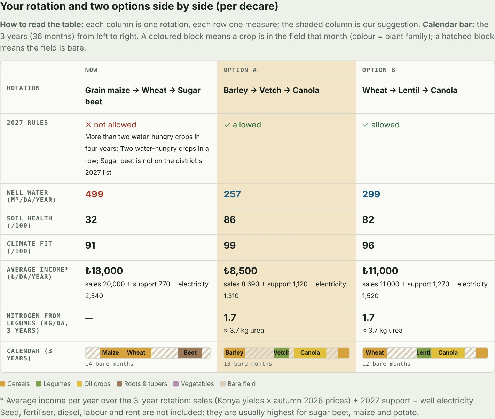
*Today's rotation against two legal options: well water, soil health, climate fit, income and a 3-year calendar.*

## What is new

This is our own idea, not a suggested project. Reinforcement learning has been used for crop planning in research simulators before (for example CyclesGym, NeurIPS 2022). What we add:

* **Real rules as hard limits.** The agent can never pick a move that breaks Konya's 2027 rules.
* **Real weather and real climate futures.** 41 years of NASA POWER weather and 6 NASA CMIP6 climate models drive the simulator.
* **An honest test.** The agent is tested on years and climate models it did not train on.
* **An exact referee.** We compute the exact optimum of the expected score with dynamic programming and measure how close the agent gets.

## How it works

**A virtual field.** Our FieldRota crop table gives average values for 14 crops plus fallow: water use from the TAGEM–DSİ (2017) Çumra guide (canola: ministry value; safflower: nearby stations), a soil-health score for every 3-crop sequence, and 2041–2060 values from 6 NASA NEX-GDDP-CMIP6 climate models. Daily NASA POWER weather for Çumra (1985–2025, 14,975 days) turns these averages into **year-by-year** values:

* hotter, drier seasons need more water (FAO-56 reference evapotranspiration);
* rain cuts pumping;
* each day at or above 35 °C in a crop's most heat-sensitive month lowers its climate fit.

**The agent.** Tabular **Q-learning**: a table that answers "after crops X then Y, how good is planting Z in the long run?", improved by trial and error over millions of simulated seasons.

* **Action:** next year's crop. Moves that break the rules are never offered.
* **Reward:** FieldRota's yearly score, mixing well water, climate fit and soil health by the farmer's goal (save water = 7 : 2 : 1).
* **Two versions, trained the same way:**
  * **Real-weather agent:** also sees whether last year was wet or dry. Trained on 1986–2008, best of 3 runs picked on 2009–2014, tested on 2015–2025.
  * **Climate-model agent (the one in the app):** also sees the decade. Trained on 2026–2060 futures from 3 climate models (each future year = the model's warming trend plus the weather swings of a real 1986–2025 year), best of 3 runs picked on a 4th model, tested on 2 others.

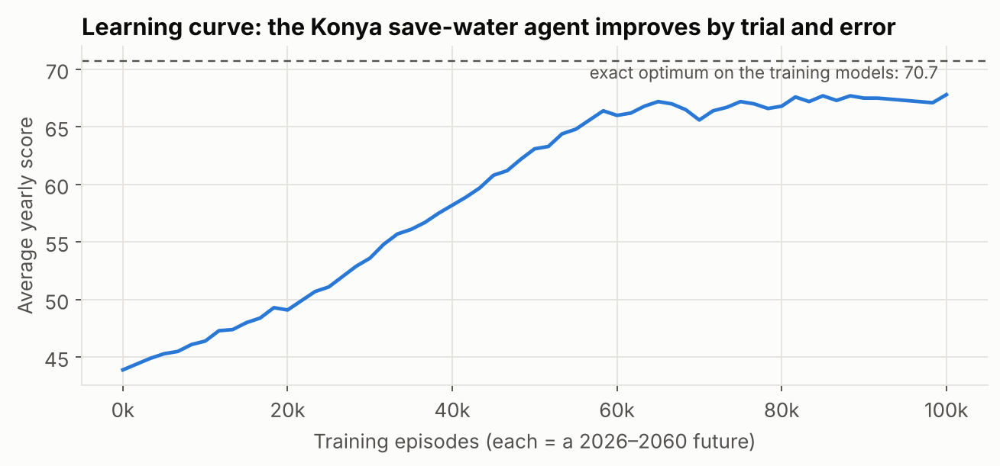
*The climate-model agent's average yearly score while it practises. It starts near 44 while it is still trying moves almost at random, and levels off about 3 points below the exact optimum on its training models (70.7); much of that gap is the exploration it keeps doing while training. The tests below use the finished policy, with no exploration.*

**Why reinforcement learning?** This year's crop changes what is best next year, and the climate keeps shifting, so a rotation is a chain of decisions. Today's simulator is small enough for dynamic programming to solve exactly, so DP is our referee, not our product. Q-learning needs no model of how the field responds, only the ability to try moves, which is our route to adding forecasts, soil moisture or prices.

## How we tested it

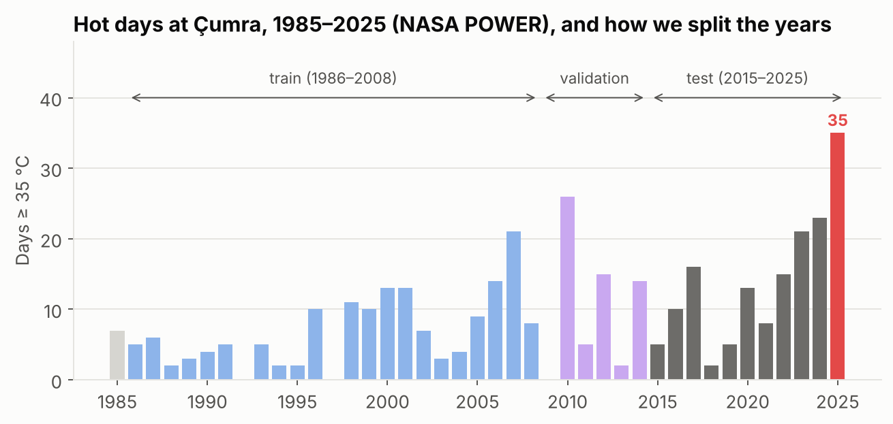
*Every year of NASA POWER data for Çumra, coloured by its role. The agent trains on 1986–2008 (blue), we pick the best run on 2009–2014 (purple), and we test on 2015–2025 (dark), which holds 2023, 2024 and 2025, three of the five hottest years. 2025 (red) is the hottest of all.*

* **Unseen real weather:** 2015–2025, real-weather agent.
* **Unseen climate models:** 2026–2060 under GFDL-ESM4 and IPSL-CM6A-LR, climate-model agent. These futures reuse real 1986–2025 weather swings, so this test checks new warming trends, not new weather.
* **Four comparisons:**
  * **Today's rotation** (maize → wheat → sugar beet): the farmer changes nothing.
  * **Myopic:** picks the best crop for this year only.
  * **FieldRota v1:** the best fixed 3-year rotation for the average climate.
  * **Exact optimum:** dynamic programming on the expected yearly score of the test climate models, our reference ceiling.

## Results

Konya, *save water* goal, in our simulator. Score goes up to 100, higher is better. Well water is in m³ per decare (1,000 m²) per year; 1 m³/da = 1 mm of water.

| Plan | Score 2015–2025 | Score 2026–2060 | Well water 2015–2025 | Well water 2026–2060 |
|---|---|---|---|---|
| **Baseline: keep today's rotation** (maize → wheat → sugar beet) | 42.2 | 36.3 | 488 | 518 |
| Myopic: best crop for this year only | 71.9 | 66.8 | 256 | 262 |
| FieldRota v1: best fixed 3-year rotation, average climate | 70.7 | 70.3 | 269 | 274 |
| **FieldRota-AI (ours)** | **70.3** | **70.4** | **269 (−45 %)** | **271 (−48 %)** |
| Exact optimum (dynamic programming, expected score) | – | 70.4 | – | – |

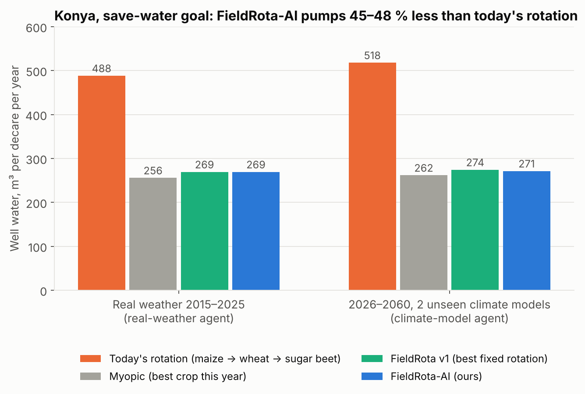
*FieldRota-AI uses about half the well water of today's rotation on both tests. Today's rotation also breaks the 2027 rules in about 2 of every 3 years; the AI never does.*

* **45–48 % less well water** than today's rotation, about 220–250 mm of water a year, with no rule breaks.
* **100 %** of the exact optimum in Konya on the unseen climate models (99.5 % on average over all 15 region × goal tests).
* **Looking ahead protects the soil.** The myopic planner saves as much water, but over 2026–2060 its soil score falls to 32 (AI: 84). On 2015–2025 it scores higher, because it grows the same three crops in another order and so had canola, not vetch, in the 2025 heat.

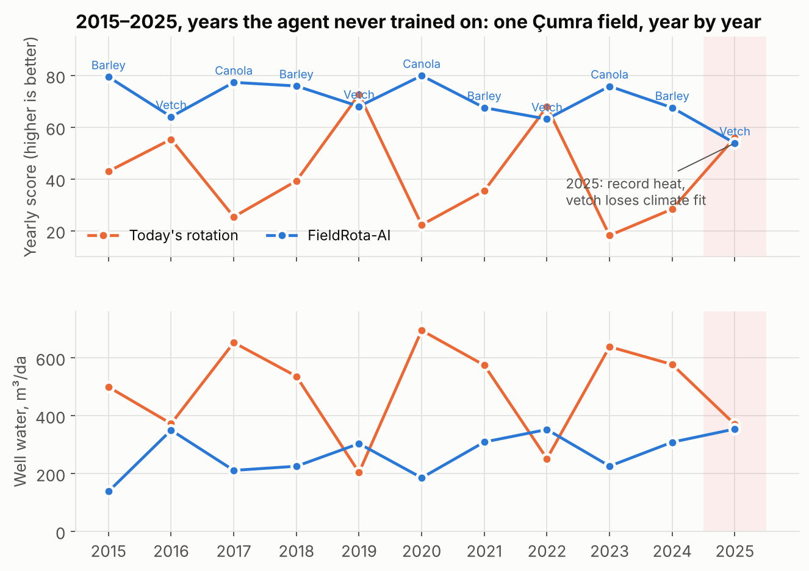
*The same field, year by year, on weather the agent never trained on. The AI (blue) cycles barley, vetch and canola. It scores above today's rotation (orange) in 8 of the 11 years and pumps less in 9 of them. 2025 is its worst year; see "Where it falls short" below.*

**Does it work elsewhere?** We ran the same method on four other groundwater hotspots.

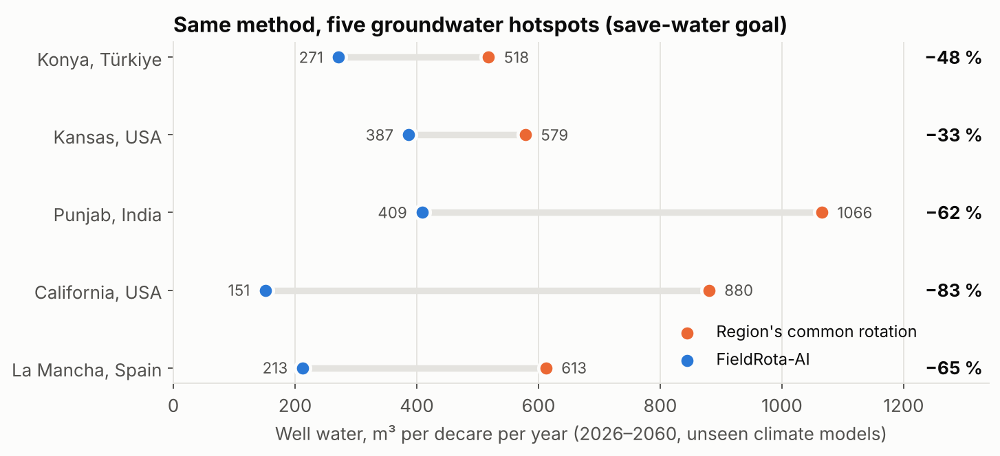
*With the save-water goal, the AI uses 33–83 % less well water than each region's common rotation on the unseen climate models.*

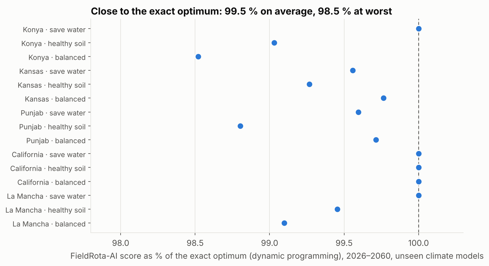
*Across all 15 region × goal tests on the unseen climate models, the AI reaches 99.5 % of the optimum on average and 98.5 % at worst (Konya, balanced goal).*

<b>Kansas: the AI changes crops as the climate warms</b>

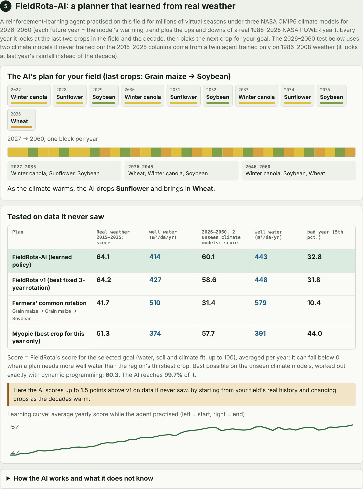
*In Kansas, with the balanced goal, the AI grows winter canola, sunflower and soybean until about 2035, then drops sunflower, whose climate fit falls as hot days increase, and brings in wheat. That puts it 1.5 points above v1's fixed rotation.*

## Where it falls short, why, and how we'll fix it

We built and tested FieldRota-AI in 48 hours, so we focused on the core: a planner that follows the real rules, learns from real weather and is checked against the exact optimum. Testing it honestly also showed us where it falls short. For each case we know the cause, and the fix is already planned.

**1. A record-hot summer can still surprise it (2025).**
* **What we saw:** 2025 had the most days at or above 35 °C in our data. In July alone NASA POWER shows 20 such days (about 13 after the simulator's calibration to FieldRota), against about 4 in an average 2011–2024 July. The agent had planted vetch, which is heat-sensitive, so climate fit fell to 54 and the score to 53.9, its lowest test year.
* **Why:** the crop is chosen in autumn, months before the summer, and this version has no forecast in its inputs. A farmer choosing in autumn faces the same blind spot. The simulator registered the heat damage, as it is designed to.
* **How we'll fix it:** add a seasonal heat forecast (for example Copernicus C3S seasonal forecasts) to the agent's state, so it can switch to heat-tolerant barley or canola before a hot summer. Tabular Q-learning can take this extra input without changing the method, and we would test it on held-out years first.

**2. In Konya it lands on the same plan as v1.**
* **What we saw:** in Konya the AI and v1 settle on the same three crops, barley, vetch and canola, in a 3-year cycle (on 2015–2025 even in the same order). Elsewhere the AI is sometimes up to 3.7 points below v1 on 2015–2025 (Kansas: 47.7 vs 51.5).
* **Why:** in Konya the climate trend is slow compared with a 3-year cycle, so the best plan really is close to a fixed rotation. Two very different methods agreeing is a strong cross-check. The small gaps come from learning from 23 single, noisy weather years.
* **How we'll fix it:** train on far more weather by resampling and mixing real seasons, and average several training runs. Where the climate does shift, the AI already adapts: in Kansas it swaps sunflower for wheat after 2035 and beats v1 by 1.5 points.

**3. It saves water, but at today's prices it earns less.**
* **What we saw:** at autumn-2026 prices plus 2027 support, the AI plan earns about 7,700 TL per decare a year. Today's rotation earns 16,400, but the 2027 rules end it. A legal wheat → sunflower → maize rotation earns 10,700, and the AI still uses 42 % less well water than that one. (Seed, fertiliser and labour are not counted.)
* **Why:** this version optimises the goal the 2027 rules set: less groundwater. Income is calculated and shown in the app, but it is not part of the reward yet.
* **How we'll fix it:** for Konya the app already has every crop's price, yield, support payment and pumping cost, so income can enter the reward as one more weight. The farmer could then choose their own balance between water and money, and the same numbers show how much extra support would close the gap.

**4. The results come from a simulator, not yet from fields.**
* **What we saw:** the simulator has no yields, pests or soil moisture carried between seasons. Its climate data covers cells about 50 km wide, and it uses one emissions scenario (SSP2-4.5).
* **Why:** a field trial takes whole seasons, so in a weekend a simulator is the only way to test 2015–2060. We built it on measured data: crop water use from TAGEM–DSİ field measurements at Çumra and 41 years of real NASA weather. By design, its average irrigation equals FieldRota's calibrated 2011–2025 values; that period overlaps our 2015–2025 test, so that test checks the agent's choices, not the simulator's calibration.
* **How we'll fix it:** add yields and soil moisture with a crop model such as FAO's AquaCrop, add a high-emissions scenario from the same NASA dataset, and check the plans against real well records and farmers' past rotations in Çumra.

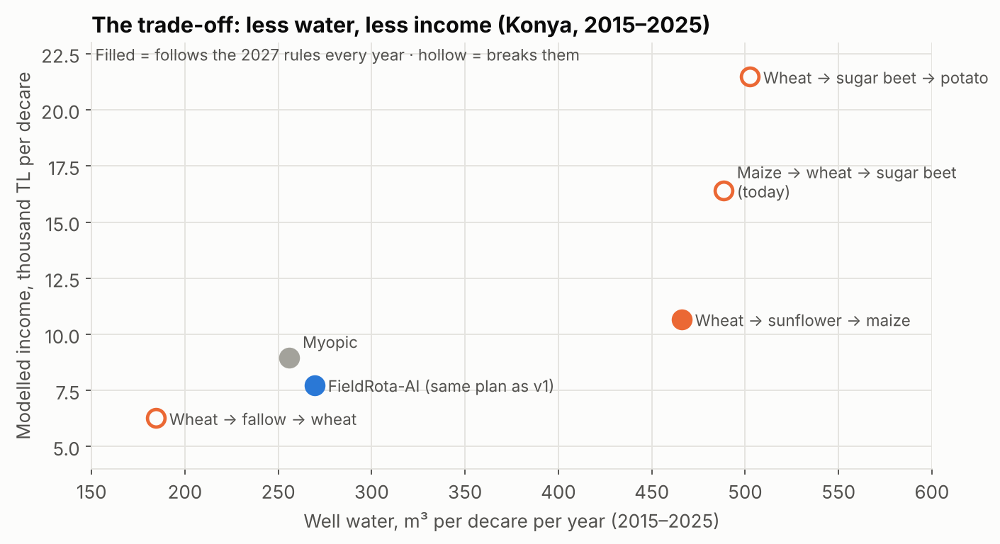
*The trade-off behind point 3. The water-saving plans (bottom left) earn less than today's rotation (top right), which breaks the 2027 rules. Hollow points break the rules; only the filled ones are allowed.*

## Run it yourself

* **Notebook:** open [FieldRota_AI.ipynb in Colab](https://colab.research.google.com/github/Mensar10/fieldrota-ai/blob/main/FieldRota_AI.ipynb) and choose *Run all* (about 5 minutes). It downloads NASA POWER live and falls back to the saved copy in `data/weather/` if the API is down.
* **Web app:** open the [live app](https://mensar10.github.io/fieldrota-ai/app/), or double-click `app/index.html` (it works offline).
* **Retrain everything:** `python export_ai.py` (about 25 minutes), then `python tools/build_app.py`.
* **Charts in this README:** `python tools/make_readme_charts.py`.

<b>What is in this repository</b>

| Path | What it is |
|---|---|
| `fieldrota_ai.py` | simulator, rules, Q-learning, baselines, dynamic-programming optimum, evaluation |
| `FieldRota_AI.ipynb` | end-to-end notebook with every test and output |
| `export_ai.py` | trains every region and goal, writes `ai/*.json` and `results/*.csv` |
| `data/` | FieldRota region data and saved NASA POWER weather |
| `ai/`, `results/` | trained policies and test results |
| `app/` | the FieldRota web app (section 5 = FieldRota-AI) |
| `tools/` | app build scripts and the README chart script |
| `docs/img/` | screenshots and charts used here |
| `DETAILS.md` | the long technical write-up: every region, the full test design and all limits |

## Sources
* **NASA POWER daily agroclimatology:** https://power.larc.nasa.gov
* **NASA NEX-GDDP-CMIP6 climate projections, SSP2-4.5, 6 models** (Thrasher et al., 2022): https://www.nccs.nasa.gov/services/data-collections/land-based-products/nex-gddp-cmip6
* **NASA GRACE groundwater context:** https://grace.jpl.nasa.gov
* **FAO-56, Crop evapotranspiration** (Allen et al., 1998): https://www.fao.org/3/x0490e/x0490e00.htm
* **Çumra crop water use:** *Türkiye'de Sulanan Bitkilerin Bitki Su Tüketimleri Rehberi*, TAGEM–DSİ (2017). Described in TAGEM's SUET guide: https://www.tarimorman.gov.tr/TAGEM/Belgeler/TAGEM_SUET_KullaniciKilavuzu.v.1.0.pdf
* **Çumra 2027 crop list, rotation rules and support payments:** Türkiye Ministry of Agriculture and Forestry, https://www.tarimorman.gov.tr
* **Konya income figures (shown, not optimised):**
  * yields from the Konya Provincial Directorate of Agriculture and Forestry (2023–24), https://konya.tarimorman.gov.tr; irrigated wheat yield estimate (500–750 kg/da) from a DergiPark source, in line with Konya irrigated variety trials such as Aydoğan and Soylu (2017): https://dergipark.org.tr/tr/download/article-file/513334
  * prices from the Konya Commodity Exchange (https://www.ktb.org.tr), TMO (https://www.tmo.gov.tr), TÜRKŞEKER (https://www.turkseker.gov.tr) and Konya Şeker (https://www.konyaseker.com.tr), autumn 2026; hay prices from TÜSEDAD, May 2026 (reported at https://www.timeturk.com/hububat-hasadiyla-kaba-yem-fiyatlari-cakildi); potato and onion estimates from the Konya wholesale market (October 2026) and TEPGE 2025 producer prices (https://arastirma.tarimorman.gov.tr/tepge)
  * irrigation electricity tariff from EPDK (https://www.epdk.gov.tr)
  * well pumping energy from Topak, Yavuz and Süheri (2008), Selcuk Journal of Agriculture and Food Sciences 22(45): https://dergipark.org.tr/en/pub/selcukjafsci/article/1291074
  * nitrogen left after a legume (about 1.7 kg N per decare) from Akın, ¹⁵N carry-over study after spring lentil in Central Anatolia: https://kurumsalarsiv.tenmak.gov.tr/items/2045061e-b7b4-416e-975e-43f4e1d49b8b
* **Satellite images, maps and fonts in the app:**
  * NASA Blue Marble: Next Generation and NASA HLS (30 m) via NASA GIBS: https://www.earthdata.nasa.gov/engage/open-data-services-software/earthdata-developer-portal/gibs-api, https://hls.gsfc.nasa.gov
  * Copernicus Sentinel-2 L2A (10 m) via Earth Search / AWS Open Data: https://registry.opendata.aws/sentinel-2-l2a-cogs/ (contains modified Copernicus Sentinel data 2026)
  * Natural Earth country and province outlines (public domain): https://www.naturalearthdata.com
  * Türkiye province and district outlines: geoBoundaries gbOpen TUR ADM1/ADM2 (Runfola et al., 2020), https://www.geoboundaries.org, based on OpenStreetMap data © OpenStreetMap contributors (https://www.openstreetmap.org/copyright)
  * Fonts: Bricolage Grotesque, Source Sans 3 and JetBrains Mono via Google Fonts (SIL Open Font License): https://fonts.google.com
* **Related work:** Turchetta et al. (2022), *Learning Long-Term Crop Management Strategies with CyclesGym*, NeurIPS: https://proceedings.neurips.cc/paper_files/paper/2022/hash/4a22ceafe2dd6e0d32df1f7c0a69ab68-Abstract-Datasets_and_Benchmarks.html
* **Libraries:** NumPy (https://numpy.org), pandas (https://pandas.pydata.org), Matplotlib (https://matplotlib.org), D3 (https://d3js.org), topojson-client (https://github.com/topojson/topojson-client)
* **AI tools:** Claude by Anthropic (https://claude.ai), used through Claude Code (https://claude.com/claude-code), helped write and debug code and text at our direction and made the commits in this repository. We chose the problem, data, method and tests, checked the results and can explain every part.
* **No pretrained models or tutorials were used.** All code was written during the hackathon (14–15 November 2026), including the FieldRota web app (v1).
